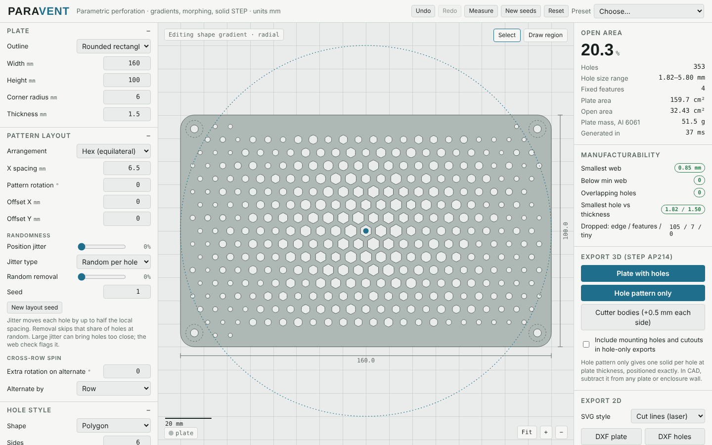
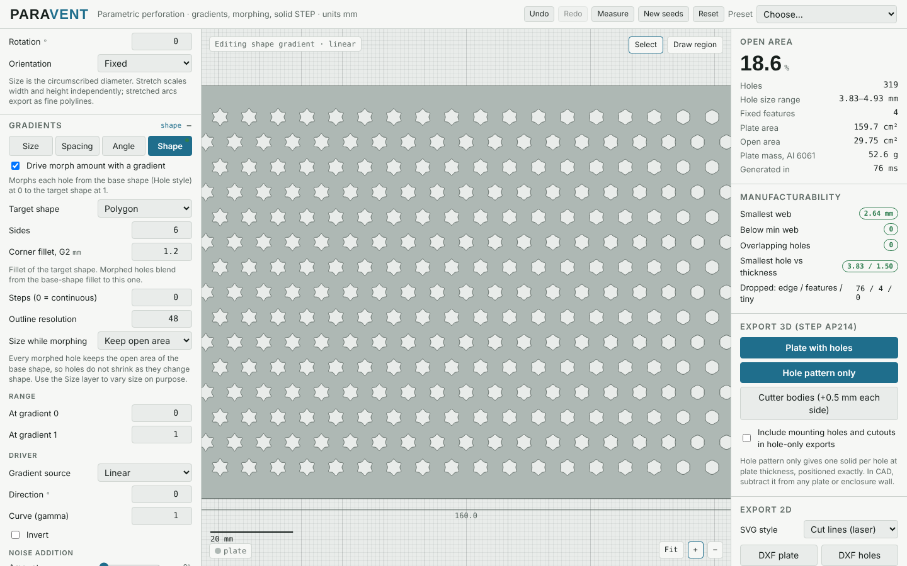
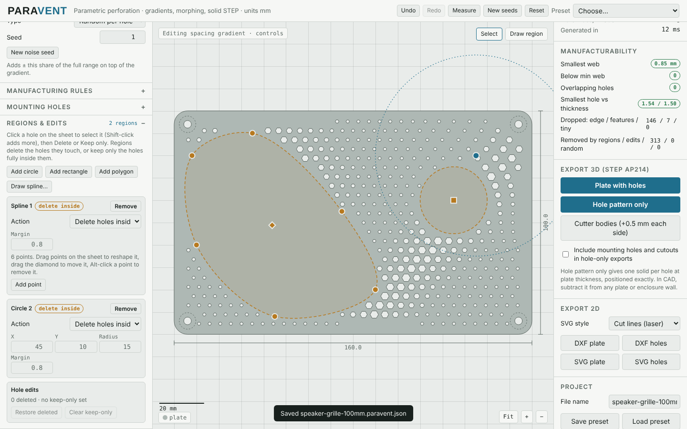

# ParaVent

<p align="center">
  <a href="https://ajaykrishnan919.github.io/paravent/"><strong>▶&nbsp;&nbsp;Open ParaVent in your browser</strong></a>
  &nbsp;&nbsp;·&nbsp;&nbsp;
  <a href="https://github.com/ajaykrishnan919/paravent/raw/main/index.html">Download for offline use</a>
  &nbsp;&nbsp;·&nbsp;&nbsp;
  <a href="#using-the-editor">User guide</a>
</p>

<p align="center"><b>Live app:</b> <a href="https://ajaykrishnan919.github.io/paravent/">https://ajaykrishnan919.github.io/paravent/</a>. No install or sign-up; runs entirely in your browser.</p>

**Parametric perforation and vent-pattern generator with manufacturing-grade CAD export.**

ParaVent designs hole patterns for ventilation panels, speaker grilles, decorative screens and halftone artwork, then exports them as **true solid STEP models (AP214 B-rep)**, **DXF R12** and **true-scale SVG**. Hole size, spacing, rotation and shape can each follow their own gradient. Shapes can morph from one to another, sharp corners get **curvature-continuous (G2) fillets**, and every pattern is checked for manufacturability as you edit.

It is a single HTML file with no install, no server and no build step for users. Open `index.html` in a browser and start designing.



---

## Contents

- [Features](#features)
- [Quick start](#quick-start)
- [Using the editor](#using-the-editor)
  - [Layout of the screen](#layout-of-the-screen)
  - [Plate](#plate)
  - [Pattern layout](#pattern-layout)
  - [Hole style](#hole-style)
  - [Gradients](#gradients)
  - [Manufacturing rules](#manufacturing-rules)
  - [Mounting holes](#mounting-holes)
  - [Regions and edits](#regions-and-edits)
  - [Custom shape editor](#custom-shape-editor)
  - [Canvas controls and shortcuts](#canvas-controls-and-shortcuts)
- [Exporting](#exporting)
- [Typical workflows](#typical-workflows)
- [Preset file format](#preset-file-format)
- [How it works](#how-it-works)
- [Core API reference](#core-api-reference)
- [Editor (UI) function reference](#editor-ui-function-reference)
- [Development](#development)
- [Limitations](#limitations)
- [Contributing](#contributing)
- [License](#license)

---

## Features

| Area | What you get |
|---|---|
| **Plates** | Rounded rectangle, circle, regular polygon, or any outline imported from SVG. Inner SVG paths become fixed cutouts. |
| **Layouts** | Hex, diamond/staggered, square grid, concentric rings, Fibonacci sunflower, Archimedean spiral, blue noise, random scatter. Rotation, offset, and cross-row spin by row, column or checker. |
| **Layout randomness** | Position jitter (random or smooth, flowing), random removal, seeded and repeatable. |
| **Hole shapes** | Circle, polygon, star, rectangle, slot (obround), and custom shapes drawn in the editor or imported from SVG. Independent width and height stretch. |
| **Gradients** | Four independent channels: **Size**, **Spacing**, **Angle** and **Shape (morph)**. Each is driven by a constant, linear, radial, point and line controllers, smooth noise, random per hole, or an image. Each has gamma, invert and **added noise**. |
| **Shape morphing** | Blend any base shape into any target shape. Continuous or stepped. Hole size can stay constant (keep open area), keep the outer diameter, or scale to a set factor. |
| **G2 fillets** | Curvature-continuous corner blends on base shapes, morph targets and every morphed, stretched or custom shape. |
| **Regions** | Circle, rectangle, polygon and free-drawn closed splines. Each region either **deletes** the holes it touches or **keeps only** the holes fully inside it. |
| **Selection edits** | Click holes to select them, then **Delete** or **Keep only**. Edits persist with the design. |
| **Manufacturability** | Minimum web, edge margin, minimum hole size, overlap detection, hole size vs. material thickness, open-area %, plate mass. |
| **Export** | STEP plate solid, **hole pattern only** (one solid per hole), cutter bodies for boolean cuts in CAD, DXF R12 (layered), SVG cut lines or filled artwork, all in millimetres. |
| **Project** | Presets, save/load JSON, undo/redo (Ctrl+Z / Ctrl+Shift+Z), measuring tool, light and dark themes, phone layout. |

## Quick start

**Use it:**

1. Download or clone this repository.
2. Open `index.html` in Chrome, Edge, Firefox or Safari. It works offline.
3. Pick a preset from the **Preset** menu at the top right, or start editing the default panel.
4. Export with **Plate with holes** (STEP), **Hole pattern only** (STEP), or the DXF and SVG buttons.

**Host it:** enable GitHub Pages (*Settings → Pages → Deploy from branch → `main` / root*). The editor is then available at `https://<user>.github.io/paravent/`.

**Develop it:**

```bash
npm test          # unit tests (Node 18+, no dependencies)
npm run build     # inline src/core.js into src/app.html -> index.html
npm run validate:step   # optional: validate sample STEP files with OpenCascade (pip install cadquery-ocp)
```

## Using the editor

### Layout of the screen

| Region | Purpose |
|---|---|
| **Left rail** | All design parameters, grouped in collapsible sections. |
| **Sheet (centre)** | Live preview at true scale with a millimetre grid, dimensions and a scale bar. Drag to pan, scroll to zoom. Draggable handles appear for gradient controllers, regions and manual mounting holes. |
| **Right rail** | Open area, statistics, manufacturability checks and all exports. |
| **Header** | Undo, redo, measure, new random seeds, reset, presets. |

Number fields apply after you stop typing. A value outside its allowed range turns red and is clamped when you leave the field.

### Plate

| Setting | Meaning |
|---|---|
| Outline | *Rounded rectangle*, *Circle*, *Regular polygon* or *Custom (SVG outline)*. |
| Width / Height / Corner radius | Rectangle size in mm. |
| Diameter / Sides / Rotation | Circle and polygon size; polygon diameter is across corners. |
| Import outline SVG | For custom plates. The largest closed path is the outline; inner closed paths become **cutouts** (connector windows, displays). SVG units are read as mm, and **Width** rescales the whole outline. See `examples/plate-with-cutouts.svg`. |
| Thickness | Plate thickness in mm. Used for STEP extrusion, mass and the hole-vs-thickness check. |

### Pattern layout

| Setting | Meaning |
|---|---|
| Arrangement | **Hex** (equilateral rows), **Diamond/staggered** (independent X/Y spacing, alternate rows offset), **Square grid**, **Concentric rings**, **Fibonacci/sunflower** (equal-area phyllotaxis), **Archimedean spiral**, **Blue noise** (Poisson-disk, organic but evenly spaced), **Random scatter**. |
| X / Y spacing, Ring / turn spacing | Centre-to-centre distances in mm. |
| Centre hole, Stagger alternate rings | Options for radial layouts. |
| Pattern rotation, Offset X / Y | Rotate and shift the whole lattice. |
| **Randomness** | **Position jitter** moves each hole by up to half the local spacing. *Random per hole* scatters independently; *Smooth (flowing)* moves neighbours together in waves (set **Flow size**). **Random removal** skips that share of holes. **Seed** makes the result repeatable. |
| Cross-row spin | Adds rotation to alternate rows, columns or a checkerboard, for example 90° slots on a checker for a woven look. |

### Hole style

| Setting | Meaning |
|---|---|
| Shape | Circle, polygon, star, rectangle, slot or custom. |
| Sides / Points, Inner ratio, Width ratio, Height/width | Shape parameters. |
| **Corner fillet, G2** | Curvature-continuous blend radius in mm for every sharp corner (shown for shapes that have corners). |
| Edit custom shape… | Opens the [custom shape editor](#custom-shape-editor). |
| Size | Circumscribed diameter in mm (slots: overall length). Used whenever the Size gradient is off. |
| Stretch width / height | Independent X and Y scale. Stretched arcs export as fine polylines. |
| Rotation, Orientation | Fixed angle, face the plate centre, or random (with randomness and seed). |

### Gradients

Four tabs, each an independent layer. A green dot marks the layers that are on.

| Tab | Drives | Range units |
|---|---|---|
| **Size** | Hole size. **Off by default**: holes keep the base size until you switch this layer on. | mm |
| **Spacing** | Local pitch multiplier, so holes get denser or sparser across the plate. | × |
| **Angle** | Rotation added to each hole. | ° |
| **Shape** | Morph amount from the base shape (0) to the **target shape** (1). | 0–1 |

Every tab has the same structure:

- **Range**: the value at gradient 0 and at gradient 1.
- **Gradient source**:
  - *Constant*: one level everywhere.
  - *Linear*: along a direction.
  - *Radial*: distance from a draggable centre.
  - *Point & line controls*: draggable attractors. Each has a reach, a strength (negative subtracts) and a falloff curve (smooth, linear, sharp, hard edge). Lines can be infinite or affect one side only.
  - *Noise field (smooth)*: organic variation with a feature size.
  - *Random per hole*: an independent value for each hole.
  - *Image*: upload a picture; dark areas give 1. There is an optional underlay.
- **Curve (gamma)** and **Invert**.
- **Noise addition**: adds ± a share of the full range on top of any source, either *random per hole* or *smooth*, with a seed.

The **Shape** tab adds:

| Setting | Meaning |
|---|---|
| Target shape + parameters | Any shape type, with its own **Corner fillet, G2**. Morphed holes blend the fillet between base and target values. |
| Steps | 0 = continuous morph. *N* = snap to *N* discrete shapes. Combine with *Random per hole* for a random mix of N shapes. |
| Outline resolution | Points used to describe morphed outlines. More points means smoother shapes and larger STEP files. |
| Size while morphing | **Keep open area** (default, holes do not shrink as they change shape), **Keep outer diameter**, or **Scale to a set factor** at the target. |

Morph correspondence keeps every sharp corner of both shapes, so star tips and polygon corners are never cut off mid-morph.



### Manufacturing rules

| Setting | Meaning |
|---|---|
| Edge margin | Minimum distance from any hole to the plate outline. |
| Min web between holes | Minimum material between neighbouring holes. Thinner webs are outlined amber on the sheet. |
| Min hole size | Holes smaller than this are dropped (punch or laser limit). |
| Clip holes at outline | For artwork only: holes crossing the outline are clipped in SVG. DXF and STEP always keep complete holes. |

Rule of thumb for punched or laser-cut sheet: hole size and web ≥ material thickness. The right rail reports smallest web, webs below the minimum, overlaps, smallest hole vs. thickness, and how many holes were dropped and why.

### Mounting holes

Automatic corners (rectangles: four; polygons: one per corner; circles: an even ring with a count) or **manual positions** dragged on the sheet. Each mounting hole has a diameter and a clearance ring that pattern holes keep away from.

### Regions and edits



**Selecting holes**
- Click a hole to select it. Shift-click adds or removes holes.
- **Delete** (or the Delete key) removes the selection. **Keep only** removes everything except the selection.
- Edits are stored by position. If you change the pattern so an edited hole no longer exists, the panel says how many edits no longer match.
- **Restore deleted** and **Clear keep-only** undo edits in bulk. Ctrl+Z also works.

**Regions**
- **Add circle / rectangle / polygon** creates an editable region. Drag its square handle on the sheet, or type its values.
- **Draw region** draws a free spline:
  - Click to place points. Drag a point to adjust it, Backspace removes the last one.
  - Click the first point or press Enter to close. Esc cancels.
  - After closing, choose **Delete holes inside** or **Keep only inside**.
- After drawing, drag spline points to reshape, drag the diamond to move the whole curve, Alt-click a point to remove it, or use **Add point**. Open curves are never applied.
- Each region has an **Action** (delete inside / keep only inside) and a **Margin** (clearance to holes).
- *Delete* regions remove any hole that touches them (within the margin). With one or more *Keep* regions, only holes **fully inside** a keep region survive.

### Custom shape editor

Opened from *Hole style* or from the Shape gradient's target.

- Click to add points around the outline. Drag to move, Alt-click or right-click to delete.
- **Mirror**: *Left/right* (draw the right half) or *Four-way* (draw the top-right quarter).
- **Snap to 0.05 grid**.
- **Start from** circle, hexagon, star, teardrop or cross.
- **Import** an SVG (`<path>`, `<polygon>`, `<rect>`, `<circle>`, `<ellipse>`), or paste raw path data (`M … C … Z`). Curves are flattened; the largest closed path is used.

Shapes are centred and normalised to a circumscribed diameter of 1, then scaled by *Size*. Outlines that cross themselves are rejected, so exports stay valid.

### Canvas controls and shortcuts

| Action | How |
|---|---|
| Pan / zoom | Drag empty space / mouse wheel, or **Fit**, **+**, **−** |
| Select holes | Click, Shift-click |
| Delete selection / clear selection | Delete or Backspace / Esc |
| Draw a region | **Draw region**, then click points, then Enter or click the first point. Backspace undoes a point; Esc cancels. |
| Measure | **Measure**, then drag. Shows length, Δx and Δy in mm. |
| Undo / redo | Ctrl+Z / Ctrl+Shift+Z |

## Exporting

| Button | Output | Use it for |
|---|---|---|
| **Plate with holes** | `name.step`: one manifold solid; planar and cylindrical faces, true arcs for circles and slots. | Sheet-metal parts, machining, enclosure panels. |
| **Hole pattern only** | `name-holes.step`: one solid per hole, exactly plate thickness, z = 0…t, in plate coordinates. | Subtract the pattern from any existing part in your CAD (SolidWorks: *Insert → Part*, then *Combine → Subtract*). |
| **Cutter bodies** | `name-cutters.step`: one solid per hole, 0.5 mm proud on each side. | Boolean cuts into curved or thicker walls without coincident faces. |
| **DXF plate / DXF holes** | R12 ASCII, mm. Layers `OUTLINE`, `HOLES`, `MOUNTING`, `CUTOUTS`. Circles as `CIRCLE`, slots as `LINE` + `ARC`. | Laser, waterjet and CNC CAM; sketch import in CAD. |
| **SVG plate / SVG holes** | True scale in mm. *Cut lines* (hairline strokes) or *Filled artwork*. | Laser software, print, documentation. |
| **Save / Load preset** | `name.paravent.json`, the complete design. | Versioning designs, sharing, reuse. |

Mounting holes and cutouts can be included in hole-only exports with the checkbox. Overlapping holes and holes touching the outline are skipped automatically, so the exported solid is always valid. The editor reports how many were skipped.

**About file size:** circles and slots export as exact arcs. Filleted, morphed, stretched and custom holes export as dense polylines, which gives larger files (a few MB per few hundred holes). Lower *Outline resolution* or use *Steps* if your CAD gets slow.

## Typical workflows

**Ventilation panel in a sheet-metal enclosure**
1. Set *Plate* to your panel size and thickness. Enable *Mounting holes*.
2. Choose *Hex*, set spacing, and set *Size* (or turn on the Size gradient for a fade).
3. Set *Min web* to at least the thickness, and watch the Manufacturability panel.
4. Add *Delete* regions around bosses or labels.
5. Export **Plate with holes** (STEP) for CAD, or **DXF plate** for the laser.

**Pattern on an existing CAD part**
1. Match the plate outline to the face you're perforating (or import it as an SVG).
2. Export **Hole pattern only**. In CAD, insert it at the face origin and subtract it.

**Decorative morph screen**
1. Choose a base shape (for example, star with a 0.5 mm fillet). In *Gradients → Shape*, turn the layer on, pick a target (polygon, 1.2 mm fillet).
2. Use a *Linear* or *Radial* source, add 10–30 % noise, or use *Random per hole* with *Steps = 3* for a random mix.
3. Keep *Size while morphing* on *Keep open area* for an even look.

## Preset file format

A preset is the full design state as JSON. All lengths are in mm and angles in degrees.

```jsonc
{
  "app": "ParaVent", "version": 2,
  "params": {
    "plate":   { "shape": "rect|circle|polygon|custom", "w": 160, "h": 100, "r": 6, "d": 120, "sides": 6, "rot": 0, "t": 1.5,
                 "custom": null /* or { outer:[[x,y]...], inner:[[[x,y]...]], w, h } from SVG import */ },
    "layout":  { "type": "hex|stagger|grid|radial|fibonacci|spiral|poisson|random", "pitch": 5.5, "pitchY": 5.5, "ringStep": 5.5,
                 "rot": 0, "ox": 0, "oy": 0, "center": true, "stagger": true, "seed": 3,
                 "jitter": 0, "jkind": "random|smooth", "jscale": 20, "dropout": 0, "jseed": 1 },
    "hole":    { "shape": "circle|polygon|star|rect|slot|custom", "sides": 6, "starK": 0.5, "slotW": 0.35, "aspect": 1,
                 "custom": [[x,y], ...] /* unit outline */, "fillet": 0, "d": 3.5, "sx": 1, "sy": 1, "rot": 0,
                 "rotMode": "fixed|radial|random", "jitter": 1, "seed": 7, "spin": 0, "spinBy": "row|col|checker" },
    "grad": {
      "size":    { "on": false, "min": 1.2, "max": 4.4, "field": FIELD },
      "spacing": { "on": false, "min": 0.85, "max": 1.5, "field": FIELD },
      "angle":   { "on": false, "min": 0, "max": 90, "field": FIELD },
      "shape":   { "on": false, "min": 0, "max": 1, "steps": 0, "res": 48, "keep": "area|outer|scale", "scaleAt": 0.7,
                   "target": { "shape": "star", "sides": 5, "starK": 0.5, "fillet": 0, "...": "same keys as hole" }, "field": FIELD }
    },
    "dfm":     { "edge": 4, "web": 0.8, "minFeat": 1.0, "clip": false },
    "mounts":  { "enabled": true, "mode": "auto|manual", "d": 3.4, "inset": 6, "clear": 2, "count": 4, "list": [{ "x": 0, "y": 0 }] },
    "regions": [ { "kind": "circle|rect|polygon|spline", "mode": "cut|keep", "gap": 0.8,
                   "x": 0, "y": 0, "r": 15, "w": 40, "h": 25, "sides": 6, "rot": 0, "pts": [[x,y], ...], "closed": true } ],
    "edits":   { "del": [[x,y], ...], "only": [[x,y], ...] }
  }
}
// FIELD = { "type": "uniform|linear|radial|controls|noise|random|image", "level": 1, "angle": 0, "cx": 0, "cy": 0, "radius": 80,
//           "gamma": 1, "invert": false, "base": 0, "noiseScale": 28, "seed": 1,
//           "controls": [ { "k": "point|line", "x": 0, "y": 0, "x2": 30, "y2": 0, "r": 40, "s": 0.8,
//                           "fall": "smooth|linear|sharp|hard", "inf": false, "side": false } ],
//           "noise": { "amt": 0, "kind": "random|smooth", "scale": 15, "seed": 1 } }
```

Missing keys fall back to defaults, so older presets keep loading. Image sources are not stored in presets; upload the image again after loading. See `examples/presets/` for complete files.

## How it works

```
params ──► layoutPoints ──► per point: jitter / removal ──► size, angle, morph channels ──► hole outline
                ▲ spacing channel                                                              │
                                                                                   G2 fillet ◄──┘
                                                                                       │
     plate edge, mounting/cutouts, regions ◄─────────────────────────────── containment & clearance
                                                                                       │
                                             selection edits ──► web/overlap check ──► model
                                                                                       │
                                                         toSTEP / toDXF / toSVG ◄──────┘
```

**Geometry representation.** Every outline is a closed *loop* of segments: lines `{t:'l', a, b}` or arcs `{t:'a', c, r, a0, a1}` (counter-clockwise when `a1 > a0`). Plate outlines run counter-clockwise and holes clockwise, so the material is always on the left of travel. That convention makes the B-rep face orientation in STEP fall out directly.

**Solid STEP.** Each solid is built face by face as an AP214 `MANIFOLD_SOLID_BREP`:
- a top and a bottom planar face with one outer bound and one inner bound per hole;
- one side face per loop segment: a `PLANE` for lines, a `CYLINDRICAL_SURFACE` for arcs.

Circles are split into two half-arcs, so no seam edges are needed. Every edge is shared by exactly two faces with opposite orientation, giving a closed, valid manifold. Sample files are validated in OpenCascade (BRepCheck plus exact volume comparison) by `npm run validate:step`.

**G2 fillets.** Each sharp corner (turn > 15°) is replaced by a quintic Bézier. Its first three control points lie on the incoming edge and its last three on the outgoing edge. That makes the second derivative parallel to the edge at both ends, so curvature is exactly zero where the blend meets the straight edge: position, tangent *and* curvature are continuous. The setback is `1.6 · r · tan(θ/2)`, measured along the outline across short segments and capped at 48 % of the distance to the neighbouring corners.

**Morph correspondence.** Base and target outlines are sampled at a shared set of arc-length parameters that includes every corner of either shape, starting where each outline crosses the +X axis. Intermediate shapes are point-wise linear blends. *Keep open area* rescales each blend by `sqrt(A_base / A_blend)`.

**Manufacturability.** Hole-to-hole gaps use exact circle distances, or an exact polyline distance (segment intersection plus vertex-segment distance) for other shapes, through a spatial hash. Plate containment uses a signed distance function per outline type, with an exact vertex check near the edge.

## Core API reference

`src/core.js` exposes a global `VF` object (browser) or `module.exports` (Node, CommonJS). It has no dependencies and no DOM access.

```js
const VF = require('./src/core.js');
const model = VF.generate(params);                       // params as in the preset format
const step  = VF.toSTEP(model, { mode: 'holes', thickness: 2, name: 'panel' });
require('fs').writeFileSync('panel-holes.step', step.text);
```

### Public functions

| Function | Description |
|---|---|
| `generate(P, sampler?)` | **Main entry.** Builds the full pattern from a params object. `sampler(x, y) → 0..1` is required only for *Image* gradient sources. Returns `{ plate, outer, holes, fixed, mounts, regions, pts, stats }`. Each hole is `{ cx, cy, D, R, rot, t, loop, pts, circ, area, partial, viol }`: centre, size, bounding radius, rotation, morph amount, exact loop, flattened outline, circle radius if circular, area, clipped flag, and web-violation level (0 ok, 1 thin, 2 overlapping). `stats` reports count, areas, open %, min web, violations, drop counts by reason, cap/truncation flags, unmatched edits and generation time. |
| `toSTEP(model, { mode, thickness, name, author, org, includeFixed })` | Writes an AP214 STEP file. `mode`: `'plate'` (one solid with through-holes), `'holes'` (one solid per hole at plate thickness), `'cutters'` (one solid per hole, 0.5 mm proud each side). Returns `{ text, solids, holes, removed, partialSkipped, entities }`. |
| `toDXF(model, { holesOnly })` | Writes DXF R12 (mm) with layers OUTLINE, HOLES, MOUNTING, CUTOUTS. Circles become `CIRCLE`; other loops become `LINE` and `ARC` entities. |
| `toSVG(model, { style, holesOnly, color, stroke, pad })` | Writes a true-scale SVG in mm. `style: 'cut'` gives hairline outlines; `'fill'` gives a filled plate with holes knocked out (clipped holes masked to the outline). |
| `exportHoles(model)` | Returns the holes safe for solid export: complete holes only, skipping holes that touch the outline and greedily dropping one of each overlapping pair. Returns `{ holes, removed, partialSkipped }`. |
| `filletPoly(pts, r, minTurn = 0.26)` | G2 fillet of a closed polygon. `r` is the equivalent fillet radius (mm); corners turning more than `minTurn` radians are blended. Returns a new point list. |
| `resamplePair(LA, LB, N)` | Samples two loops at a shared parameter set (N uniform samples plus every corner of either shape). Returns `[ptsA, ptsB]` with equal length, ready for linear morphing. |
| `regionPoly(region)` | Converts a region (`circle`, `rect`, `polygon`, closed `spline`) to a polygon. Returns `null` for open splines. |
| `catmullClosed(pts, seg = 14)` | Closed centripetal Catmull–Rom spline through `pts`, `seg` samples per span. Centripetal parameterisation avoids cusps and self-loops. |
| `unitShape(spec)` | Unit hole shape (circumradius 1, centred) for `{ shape, sides, starK, slotW, aspect, custom }`. Circles and slots use exact arcs. |
| `plateLoop(plate)` | Plate outline loop (counter-clockwise): rounded rectangle with exact corner arcs, circle, polygon or custom. |
| `plateSDF(plate)` | Returns `(x, y) → signed distance` to the plate outline (negative inside). Exact for rounded rectangles and circles; polygon SDF for regular and custom outlines. |
| `plateExtent(plate)` | Bounding size `{ w, h, R }` of the plate (`R` = half-diagonal). |
| `importPlate(svgText)` | Parses an SVG into a custom-plate record: the largest closed path is the outline, inner closed paths are cutouts. Throws on missing or self-crossing outlines. |
| `shapesFromSVG(text)` | Extracts closed outlines from SVG markup or raw path data (`path`, `polygon`, `rect`, `circle`, `ellipse`). Returns point arrays in Y-up coordinates. |
| `normaliseShape(pts)` | Cleans, orients counter-clockwise, centres and scales an outline to circumradius 1. Throws if the outline crosses itself. |
| `pointInPoly(x, y, pts)` | Even-odd point-in-polygon test. |
| `selfIntersects(pts)` | True if any two non-adjacent edges of the polygon cross. |
| `flatten(loop, tol = 0.02)` | Converts a loop to polygon vertices, sampling arcs to the given chord tolerance (mm). |
| `loopArea(loop)` | Exact signed area of a loop with arcs (Green's theorem). Positive means counter-clockwise. |
| `polyArea(pts)` | Signed area of a polygon (shoelace formula). |
| `segStart(seg)`, `segEnd(seg)` | Start and end point of a line or arc segment. |
| `LIMIT`, `TAU` | Maximum holes per pattern (20,000, keeps the editor responsive) and 2π. |

### Internal functions

| Function | Description |
|---|---|
| `clamp`, `lerp`, `smooth` | Clamp to a range, linear interpolation, smoothstep `t²(3 − 2t)`. |
| `rng(seed)` | Mulberry32 pseudo-random generator, used for repeatable random layouts and rotations. |
| `hash2(x, y, seed)` | Stable per-position random value in [0, 1). Drives *Random per hole* sources, noise and jitter, so results don't change when unrelated holes are added or removed. |
| `reverseSeg`, `reverseLoop`, `orient(loop, ccw)` | Reverse segment or loop direction, and force a loop's orientation. |
| `polyLoop(pts)`, `circleLoop(cx, cy, r)` | Build loops from points, or a circle as two half-arcs (seam-free B-rep). |
| `cleanPoly(pts, eps)` | Removes duplicate and collinear vertices. |
| `segDist(px, py, a, b)` | Distance from a point to a segment. |
| `segsCross(a, b, c, d)` | Proper intersection test for two segments. |
| `polyGap(A, B)` | Clearance between two polygons: −1 when they overlap or one contains the other, otherwise the minimum distance. Used for webs, regions and fixed features. |
| `polyPointDist(x, y, P)` | Signed distance from a point to a polygon outline (negative inside). |
| `parseSVGPath(d)` | SVG path parser supporting M/L/H/V/C/S/Q/T/A/Z, absolute and relative. Béziers and elliptical arcs (endpoint → centre parameterisation) are flattened. |
| `placeLoop(loop, cx, cy, D, sx, sy, rot)` | Scales a unit loop to size `D`, applies stretch and rotation, and moves it to the hole centre. Keeps exact arcs when the stretch is uniform. |
| `outlineData(loop)`, `sampleAt(o, u)` | Arc-length tables, +X-axis start parameter and corner list for an outline; point at normalised parameter `u`. Used by `resamplePair`. |
| `hasArcs(loop)`, `filletLoop(loop, r)` | Detect arcs; apply `filletPoly` to a polyline loop (loops with tangent arcs, such as circles and slots, have no sharp corners). |
| `customPlatePts(plate)` | Scales a stored custom outline and its cutouts to the requested width. |
| `valueNoise(seed)` | Smooth 2D value noise (three octaves, normalised to 0..1). |
| `makeField(field, plate, sampler)` | Builds the `(x, y) → 0..1` function for a gradient source, including controllers and falloff (`FALL`: smooth, linear, sharp, hard), gamma, invert and added noise. |
| `channel(C, plate, sampler, default)` | Wraps a field into a channel that returns values in the channel's `[min, max]` range, or the default when the channel is off. |
| `layoutPoints(layout, plate, m)` | Candidate hole centres for each arrangement. `m(x, y)` is the spacing multiplier. Lattices march row by row with local pitch; rings march angularly and close evenly; Fibonacci accumulates equal-area steps; blue noise uses a variable-radius Bridson algorithm. Each point carries row and column indices for cross-row spin. |
| `mountCenters(mounts, plate)` | Automatic or manual mounting-hole positions. Polygon plates get one per corner, inset from both adjacent edges. |
| `bound(pts, cx, cy)` | Bounding-circle radius of points around a centre. |
| `loopPath(loop)`, `n4(x)` | SVG path data for a loop (arcs as `A` commands) and 4-decimal number formatting. |
| `StepWriter`, `.e`, `.pt`, `.dir`, `.ax` | STEP entity writer: sequential `#id` records, cartesian points, de-duplicated directions and axis placements. |
| `brepSolid(W, outer, holes, z0, h, name)` | Writes one extruded manifold solid: vertices, edges (lines and circles), edge loops, planar and cylindrical faces, closed shell. |
| `sn(x)`, `ascii(s)` | STEP real-number and string formatting. |

## Editor (UI) function reference

`src/app.html` holds the editor's markup, styles and controller script. The core is inlined at the `/*CORE*/` marker during the build.

| Function | Description |
|---|---|
| `load(obj)` | Merges a saved or partial params object with defaults and migrates older formats (keep-out circles become regions). |
| `panel()`, `row(item)`, `sec()`, `show()` | Declarative left-rail schema and its renderer. Number inputs debounce while typing and clamp on change. |
| `gradNode()`, `controlsNode(field)` | Gradient tabs editor; point and line controller cards. |
| `regionsNode()`, `listNode()` | Region cards (action, margin, geometry, add point) and the hole-edit summary; generic list editor for manual mounting holes. |
| `renderLeft()` | Rebuilds the left rail, keeping section open states and scroll position. |
| `schedule()`, `regen()` | Coalesce changes to one regeneration per frame, then redraw, update statistics and snapshot history. |
| `snapshot()`, `undo()`, `redo()`, `restore()` | 120-step history of the design, also mirrored to browser storage. |
| `draw()`, `addLoop()`, `handles()` | Canvas rendering (plate, holes, violations, selection, regions, handles, dimensions, measurement, scale bar) and the list of draggable handles. |
| `fit()`, `zoomAt()`, `toS()`, `toM()` | View fitting, zooming at the cursor, and model ↔ screen transforms. |
| `setTool()`, `hitHandle()`, `clickSelect()`, `applySel()` | Tool modes (select, draw, measure), handle hit-testing, click and Shift-click selection, and applying Delete or Keep only. |
| `finishDraw()`, `cancelDraw()`, `updateDrawBar()` | Spline-drawing workflow and its status bar. |
| `updateStats()`, `updateSelBar()` | Right-rail statistics and manufacturability chips; selection bar. |
| `openShapeEditor()`, `drawSE()`, `seFull()` | Custom-shape editor dialog, its canvas, and mirroring. |
| `sampler()` | Converts an uploaded image to a luminance sampler for *Image* sources. |
| `saveFile()`, `zipStore()`, `exportStep()` | File saving (direct download, or a zipped file inside sandboxed viewers that restrict file types), a minimal store-only ZIP writer, and STEP export with progress and skip reporting. |

## Development

```
src/core.js            geometry core: patterns, fillets, regions, SVG/DXF/STEP writers (no dependencies)
src/app.html           editor UI template (core is inlined at /*CORE*/)
scripts/build.mjs      builds index.html
scripts/make-samples.mjs  writes demanding sample patterns + expected volumes
test/core.test.mjs     unit tests (node:test)
test/validate_step.py  OpenCascade validation of sample STEP files
examples/              sample SVG outlines and presets
CLAUDE.md              conventions and publishing steps for Claude Code
tools/                 one-time setup scripts (setup.ps1, setup.sh) and the commit-msg hook
```

- Edit `src/core.js` or `src/app.html`, then run `npm run build` and commit the regenerated `index.html`. CI fails if it is stale.
- `npm test` covers pattern generation, G2 continuity, morph area preservation, random morph steps, regions, selection edits, layout determinism, custom plates, shape validation, STEP, DXF and SVG structure, and the hole cap.
- `npm run validate:step` generates every sample (plate, holes-only and cutter modes) and checks each solid in OpenCascade for B-rep validity, solid count and exact volume.

## Limitations

- Holes are single closed outlines. Shapes with interior islands (such as a ring) are not supported as hole shapes; use a custom plate with cutouts instead.
- Region and morph outlines are polylines in exports. Circles, slots and plate corners remain exact arcs.
- Patterns are capped at 20,000 holes per plate to keep editing interactive.
- The flat pattern has no sheet-metal bend awareness; perforate flat faces or use cutter bodies in CAD.
- Image sources are not saved in presets.

## Contributing

Issues and pull requests are welcome. Please run `npm test` and `npm run build` before opening a pull request, and describe the manufacturing use case behind new features. See [CONTRIBUTING.md](CONTRIBUTING.md).

## License

Licensed under the [Apache License 2.0](LICENSE). Copyright © 2026 Ajay Krishnan A.
